  
  
  
  




<a href="https://sutra-livid-psi.vercel.app"></a>

<a href="https://fyc-srmuh.vercel.app"></a><a href="https://sangam-bot.vercel.app"></a>
<a href="https://github.com/harshwardhan1507/AI-SEM-Image-Restoration"></a><a href="https://play.google.com/store/apps/details?id=com.verge.converge"></a>

<a href="https://artdrawnstudio.com"></a>

> **SEE ALSO**
>
> - [`disha(1)`](https://github.com/yash-144/disha) — campus early-warning platform with a calibrated ML risk model
> - [`rebuild(1)`](https://github.com/yash-144/Rebuild) — learn with AI, then prove you can rebuild it without AI
> - [`quorum(2)`](https://github.com/yash-144/quorum) — on-chain treasury governance on Stellar Soroban
> - [`whistlescore(1)`](https://github.com/yash-144/whistlescore) — zero-knowledge hazard reporting on Midnight
> - [`stellar-auction(1)`](https://github.com/yash-144/stellar-auction) — real-time auction dApp on Soroban
> - [`snapread(1)`](https://github.com/yash-144/snapread) — Rust desktop tool that turns screen snips into text
> - [`speckle-sem(3)`](https://github.com/yash-144/speckle-sem) — 16-block NAFNet for SEM denoising







<a href="https://yashgoel.tech"></a>

<b><code>/* you are not expected to understand this */</code></b> — museum placards for the artifacts above

 

| Artifact | What you are looking at |
|---|---|
| **DSKY** | The display and keyboard of the Apollo Guidance Computer (1969). Astronauts spoke to it in two-digit `VERB`/`NOUN` pairs. It shows `P63` (lunar descent braking) with `V16 N68`, then drops into `V05 N09` with `PROG` lit and **1202** in R1: the executive-overflow alarm from Apollo 11's landing. The computer shed low-priority work, and Mission Control called "GO". |
| **The CRT routine** | Written in the style of AGC assembly. The real Luminary 099 source has a routine commented `BURN, BABY, BURN -- MASTER IGNITION ROUTINE`. Mine ships. |
| **Punch card** | An IBM 80-column card. The holes are genuine IBM 029 Hollerith code for a FORTRAN statement: columns 1–5 hold the statement number, 6 marks continuation, 7–72 hold code, and 73–80 hold a sequence number so a dropped deck could be re-sorted. Cards really did say *do not fold, spindle or mutilate*. |
| **finger / .plan** | `finger(1)` dates to 1971 and printed whoever you asked about, plus their `~/.plan`. id Software's John Carmack famously kept his dev log in one. |
| **man pages** | The section numbers mean something: 1 user commands, 2 system calls, 3 library functions, 6 games, 7 miscellany, 8 system administration. Printed on green-bar continuous-form paper, as line printers did. |
| **git log** | The hashes are decorative, except the root commit: `4b825dc` begins the hash of git's empty tree. |
| **tree -F** | `*` marks executables, `/` directories, `->` symlinks. |
| **Core memory** | Ferrite rings threaded on wires, each magnetized one way or the other to hold a bit (1950s–70s). Each ring is a day; brightness is that day's contribution quartile. A GitHub Action rewrites it every 6 hours. |
| **load averages** | `uptime` reports 1/5/15-minute system load. Here it's contributions per day over 7, 30 and 365 days. |
| **The last comment** | From the Unix V6 kernel (`slp.c`, 1975), made famous by Lions' Commentary. |

Every image here is generated by <a href="./scripts/build.mjs"><code>scripts/build.mjs</code></a>: zero dependencies, with glyphs outlined straight out of TrueType files by a hand-written font parser. The core dump refreshes via <a href="./.github/workflows/core-dump.yml">GitHub Actions</a>.

